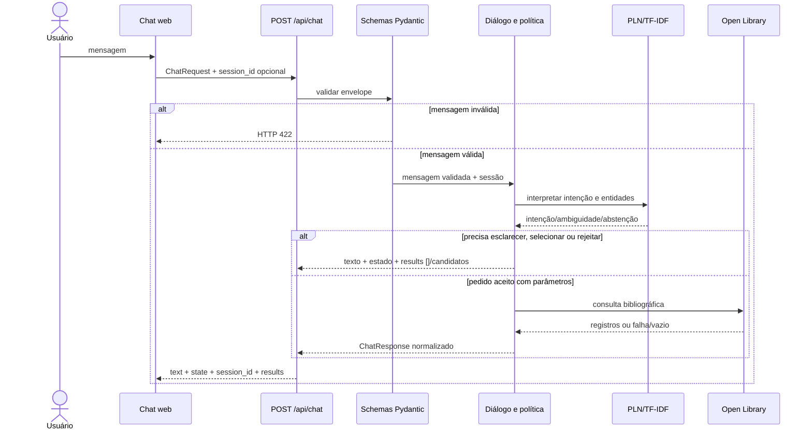

# Contrato HTTP do chat CAPITU v1

**Status:** proposta E01 pronta para revisão por Millena e Miguel.<br>
**Data:** 08/10/2026.<br>
**Implementação HTTP:** E02.<br>
**Schemas:** [`app/schemas.py`](../../app/schemas.py).

## Endpoint

`POST /api/chat` recebe uma mensagem por turno e devolve um envelope estável. O cliente fornece `session_id` depois do primeiro turno; não envia transcript nem contexto arbitrário. O servidor mantém somente o contexto mínimo previsto para esclarecimento e seleção.

### Pedido

```json
{
  "message": "Quem escreveu Dom Casmurro?",
  "session_id": null
}
```

`message` é obrigatório, limita o corpo recebido a 1000 caracteres antes de remover espaços externos e não pode ficar vazio após a remoção. `session_id` é opcional na criação e deve ser um UUID válido quando enviado.

### Resposta com livros

```json
{
  "session_id": "6f301173-2ec2-4c96-b58e-c9dc6dc2fc7b",
  "text": "Machado de Assis escreveu Dom Casmurro.",
  "state": "answered",
  "intent": "consultar_detalhes",
  "results": [
    {
      "openlibrary_key": "/works/OL12345W",
      "title": "Dom Casmurro",
      "authors": ["Machado de Assis"],
      "first_publish_year": 1899,
      "edition_count": null,
      "isbn": [],
      "subjects": [],
      "cover_url": null,
      "source_url": "https://openlibrary.org/works/OL12345W"
    }
  ]
}
```

O exemplo é ilustrativo e não comprova consulta realizada. Campos bibliográficos ausentes na fonte permanecem nulos ou listas vazias; a resposta não os inventa. `results` admite até cinco registros, inclusive zero. A política de exibição/seleção preserva a ordem recebida.

### Esclarecimento e seleção

```json
{
  "session_id": "6f301173-2ec2-4c96-b58e-c9dc6dc2fc7b",
  "text": "De qual autor você quer ver as obras?",
  "state": "awaiting_clarification",
  "intent": "buscar_obras_autor",
  "results": []
}
```

Quando a resposta pedir seleção, `state` será `awaiting_selection` e `results` conterá os candidatos na mesma ordem exibida. A seleção curta (por exemplo, “o segundo”) referencia a lista daquela sessão. Uma nova busca explícita substitui a pendência anterior. Cancelamento limpa a pendência. Contexto é isolado por `session_id`; não armazenamos transcript completo.

### Compatibilidade com o design da interface

O protótipo visual `UI Capitu.IA.pdf`, anexado à conversa e revisado em 08/10/2026, mostra conversa por texto, atalhos de busca, cartões de livros clicáveis, ação de nova conversa, indicador de disponibilidade e aviso de que os resultados são referências públicas/simuladas e devem ser conferidos.

| Elemento visual | Comportamento compatível com o contrato |
| --- | --- |
| Campo de texto e botão enviar | Envia `message` e o `session_id` corrente para `POST /api/chat`. |
| Atalhos “Buscar por título”, “Obras de um autor”, “Explorar por assunto” e “Consultar detalhes” | Inserem uma pergunta orientadora no campo; a mensagem segue pelo mesmo endpoint e pela mesma interpretação de intenção. |
| Cartões de resultados | Renderizam cada item de `results` pela ordem recebida, usando título, autores e assunto quando disponível. Campos ausentes são omitidos ou apresentados como indisponíveis, nunca inventados. |
| Clique em um cartão para pedir detalhes | A UI envia uma mensagem textual como “Detalhes de Dom Casmurro” com o mesmo `session_id`; não precisa de endpoint nem formato de pedido exclusivo para cliques. |
| “Nova conversa” | Descarta o `session_id` local e envia a próxima mensagem sem sessão, iniciando contexto independente. |
| Indicador “CAPITU está disponível” | É estado de conectividade da aplicação, não prova disponibilidade da Open Library. Se a API externa falhar, a resposta de negócio usa `source_unavailable`; o indicador não deve mascarar essa falha. A implementação do estado de conectividade da UI será validada na integração E02. |
| Aviso de referências e possíveis imprecisões | Permanece visível na UI; resultados são descoberta bibliográfica baseada na Open Library, não confirmação de acervo institucional. |

O mockup não especifica visualmente como exibir `awaiting_clarification`, `awaiting_selection`, `no_results`, `out_of_scope` ou `source_unavailable`; a UI deve representá-los como mensagens da CAPITU e renderizar cartões somente quando `results` tiver itens. A proposta preserva o envelope atual. A compatibilidade com o código funcional ainda será conferida quando a UI for integrada.

## Estados de resposta

| Estado | Uso |
| --- | --- |
| `answered` | Ação concluída com resposta bibliográfica disponível. |
| `awaiting_clarification` | Falta parâmetro obrigatório ou a interpretação é ambígua; nenhuma consulta é iniciada sem parâmetros suficientes. |
| `awaiting_selection` | Há mais de um candidato e a pessoa precisa escolher. |
| `no_results` | Consulta concluída sem correspondências na fonte; não significa que a obra inexista. |
| `out_of_scope` | Pedido fora do escopo bibliográfico; nenhuma chamada à Open Library. |
| `source_unavailable` | Timeout, falha de rede ou serviço externo indisponível; distinto de resultado vazio. |

## Erros de validação HTTP

Mensagem ausente, vazia, só com espaços, acima de 1000 caracteres, UUID inválido ou propriedades não previstas serão rejeitados pelo schema e retornarão HTTP `422` no padrão de validação do FastAPI. A interface deve apresentar mensagem simples e permitir nova tentativa. Esse erro de transporte não é resposta de intenção e não chama serviço bibliográfico.

## Intenções e entidade

| Intenção | Parâmetro principal | Exemplo diferencial |
| --- | --- | --- |
| `buscar_por_titulo` | `title` | “Procure Dom Casmurro.” |
| `buscar_obras_autor` | `author` | “Quais livros foram escritos por Machado de Assis?” |
| `buscar_por_assunto` | `subject` | “Quero livros sobre ficção científica.” |
| `consultar_detalhes` | título, ID selecionado ou referência ativa | “Quem escreveu Dom Casmurro?” |

O verbo “escrever” não escolhe sozinho a intenção: no primeiro exemplo a entidade é autor e a ação lista obras; no segundo a entidade é título e a ação consulta o campo autor. “Fora do escopo” é decisão de política, não uma quinta intenção bibliográfica do corpus.

## Precedência do diálogo

1. Validar o envelope; entrada vazia ou inválida encerra com `422`.
2. Se existe pendência e a mensagem cancela, limpar pendência sem consultar a API.
3. Uma nova solicitação explícita e reconhecida substitui pendência e entidades antigas.
4. Caso contrário, interpretar resposta curta como preenchimento da pendência ativa.
5. Seleção (“primeiro”, “segundo”) só referencia resultados da própria sessão.
6. Intenção abaixo do limiar ou com margem ambígua: esclarecer/abster-se, sem chamada externa.
7. Pedido fora do escopo: responder informativamente, sem chamada externa.
8. Intenção aceita sem parâmetro necessário: perguntar o parâmetro, sem chamada externa.
9. Só consultar a fonte com intenção e entidade suficientes; separar `no_results` de `source_unavailable`.

## Limites de v1

- Corpo de mensagem: máximo 1000 caracteres.
- Resposta: texto até 2000 caracteres e no máximo cinco livros por turno.
- Contexto: intenção/parâmetro pendente e até cinco resultados da sessão; sem transcript completo, autenticação ou persistência entre reinícios no MVP.
- Similaridade e margem são valores diagnósticos do interpretador, não probabilidades. A resposta pública não expõe score no MVP.
- Recomendações significam descoberta por assunto, não personalização.
- ISBN, capas, filtros e recomendação personalizada não entram no MVP como novas funções de busca.

Os limites numéricos são guardrails técnicos propostos na E01 para revisão da equipe; o limiar de intenção será calibrado somente em validação na E05.

## Cenários de contrato E01

| ID | Entrada | Resultado de validação esperado | Automação |
| --- | --- | --- | --- |
| E01-CT01 | JSON com mensagem válida e sem `session_id` | Pedido validado; a E02 cria/retorna UUID quando implementar o endpoint. | Schema automatizado agora; HTTP em E02. |
| E01-CT02 | `message` vazio, só espaços ou acima do limite | Schema rejeita; HTTP `422` na rota; serviço externo não é chamado. | Schema automatizado agora; HTTP em E02. |
| E01-CT03 | Resposta válida de negócio | JSON contém `text` não vazio, `state`, UUID `session_id` e `results` como lista; opções ausentes seguem nulas/vazias. | Validação do modelo agora; HTTP em E02. |

### Execução local em 08/10/2026

`pytest tests/test_schemas.py -q` terminou com **14 passed, sem warnings**. A execução cobriu validação dos schemas, limites, intents, estados, dados bibliográficos opcionais e contexto limitado. Isso comprova o nível de contrato Pydantic; não comprova ainda `POST /api/chat`, HTTP 422 ou chamadas à Open Library, que pertencem à E02 e às tasks seguintes. O registro dos três cenários CT01-CT03 está em [`evaluation/test_cases.csv`](../../evaluation/test_cases.csv).

## Diagrama



## Revisão antes do aceite

- **Millena:** revisar o mapeamento acima contra o design em `UI Capitu.IA.pdf`; conferir com a UI implementada se request/response e estados podem ser consumidos; registrar ajustes necessários.
- **Miguel:** revisar exemplos, casos de erro e lista de estados para fixtures/testes.
- **Emely:** incorporar feedback mantendo a versão v1; mudanças incompatíveis exigem nova versão do contrato.

O PDF de design foi revisado visualmente. Ele apresenta seis telas: início, envio de pergunta, resultados de autor, cartão selecionado, exploração por assunto e consulta de detalhes. O código da UI de Millena ainda não está neste repositório; portanto, a compatibilidade visual/funcional real e a revisão pelos demais integrantes continuam pendentes. Copiar o PDF para uma pasta de evidências versionada no repositório será uma tarefa de integração/documentação posterior.
