# M05 — Testes manuais de usabilidade e estados de erro

## Identificação

- Responsável: Maria Eduarda Souza dos Santos Ferreira.
- Branch: test/m05-usabilidade-estados-erro-ui.
- Commit da aplicação: 2528cc20f812251f4ae762ece66bf02753de4ae4. Nenhum arquivo da aplicação foi alterado; a execução não modificou código.
- Ambiente: aplicação local em http://127.0.0.1:8000/.
- Navegador e versão: 157.0.8103.52 (Compilação oficial) (64 bits).
- Data da execução: 17/11/2026.
- Modo: execução manual no navegador, com a aplicação normal e consultas reais à Open Library. A falha externa e o HTTP 422 foram simulados pelo console do navegador; a falha de conexão e a lentidão, pela aba Network. O mecanismo usado está identificado em cada caso.
- Situação: seis casos executados. Cinco aprovados e um com defeito confirmado (UI-14, timeout).

## Objetivo

Verificar seleção, parâmetro ausente, falha externa, retorno vazio, troca de contexto e recuperação do carregamento. A tarefa registra comportamentos e defeitos, sem alterar o código da aplicação.

## Referências

- Plano principal: casos UI-09 a UI-14 e perguntas T01 a T24 (evaluation/g05_acceptance.csv e docs/evidence/G05.md).
- Integração da interface: M03.md.
- Robustez da fonte externa: E10.md.
- Dados controlados: tests/fixtures/README.md.

## Condições gerais de execução

- Os arquivos de tests/fixtures não estão ativos no servidor; por isso as buscas foram feitas ao vivo na Open Library, e os resultados exibidos podem variar com o tempo. O critério de aprovação é o estado e o comportamento da interface, não o conteúdo exato dos livros.
- A indisponibilidade da fonte foi simulada substituindo a resposta recebida pela interface por meio de window.fetch. Essa execução verifica a apresentação e a recuperação da UI; não provoca nem comprova uma falha real da Open Library. A conversão de falhas do catálogo em source_unavailable é referenciada em tests/test_chat_integration.py (test_transient_catalog_failure_becomes_source_unavailable) e no caso T21 da G05.
- Usado o painel Network para observar requisições a /api/chat, payloads e respostas.
- Cada variação foi registrada separadamente.
- Screenshots em docs/evidence/M05-screenshots/, identificados por caso e etapa.
- Offline, HTTP 422 e resposta externa substituída com window.fetch são registrados como simulações no navegador para verificar a interface e sua recuperação. No cenário HTTP 422, o navegador envia um corpo inválido e o servidor retorna o status real; essa execução não comprova a robustez do catálogo ou da integração com a Open Library.

## UI-09 — Nova conversa e independência da sessão

**Pré-condição:** interface aberta, com uma conversa que já recebeu um session_id e resultados.

**Passos:**

1. Enviar uma mensagem e registrar o session_id retornado.
2. Acionar Nova conversa.
3. Observar o histórico e a mensagem inicial.
4. Enviar outra mensagem e inspecionar o payload e a resposta.
5. Verificar se o contexto anterior interfere na nova conversa (enviar “Procure Dom Casmurro”, “o segundo”, acionar Nova conversa e enviar “quem escreveu?”).

**Esperado:** o histórico anterior é limpo; a próxima mensagem envia session_id nulo e recebe uma nova sessão, com UUID diferente. O contexto anterior não interfere na nova conversa. O carregamento termina e os controles ficam disponíveis.

**Modo de execução e configuração:** execução ao vivo; inspeção do Payload e da Response na aba Network.

**Resultado obtido:** ao clicar em “Nova conversa”, o histórico anterior desapareceu da interface. O envio seguinte apresentou session_id: null no Payload e recebeu o novo UUID f32626b2-6358-4cf9-949c-e18f6b862279, diferente do anterior. O indicador de carregamento desapareceu e o campo de mensagem foi liberado, confirmado pela digitação. Na verificação de independência de contexto, após “Procure Dom Casmurro” e “o segundo”, a Nova conversa foi acionada e a pergunta “quem escreveu?” recebeu a resposta “Não encontrei referências na Open Library para essa busca. Isso não comprova que a obra não exista.” A resposta não usou a obra da conversa anterior.

**Situação:** passou.

**Evidências:**

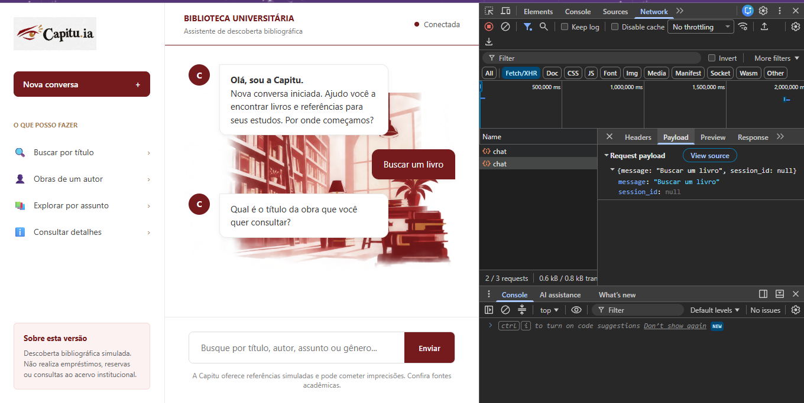

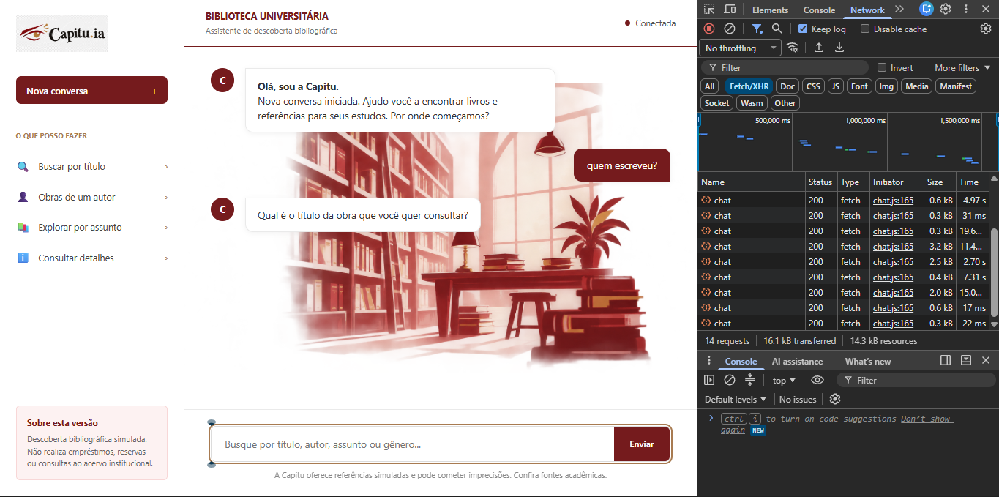

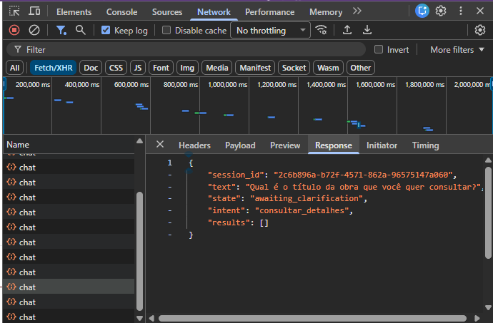

## UI-10 — Parâmetro obrigatório ausente

**Pré-condição:** conversa nova.

**Passos:**

1. Enviar “Busque um livro”.
2. Observar a pergunta de esclarecimento e a ausência de cartões.
3. Responder com o título “Dom Casmurro”.
4. Observar a continuação na mesma sessão.

**Esperado:** CAPITU solicita o título sem inventar livros. A resposta curta completa a solicitação na mesma sessão. O carregamento termina em ambos os turnos.

**Modo de execução e configuração:** execução ao vivo. O Network do navegador, isoladamente, não comprova ausência de chamadas do backend à Open Library; essa verificação é coberta pelo caso T15 da G05 (calls vazio, nas execuções fixture e live) e por tests/test_chat_integration.py (test_missing_title_asks_without_catalog_call_then_accepts_short_answer).

**Resultado obtido:** a aplicação solicitou o título: “Qual é o título da obra que você quer consultar?”. A resposta retornou state: awaiting_clarification, intent: buscar_por_titulo e results: []. Nenhum cartão foi exibido, o indicador de carregamento desapareceu e o campo de mensagem foi liberado, confirmado pela digitação sem envio. Ao responder “Dom Casmurro” na mesma sessão, a aplicação apresentou as opções de candidatos para o título.

**Situação:** passou. A ausência de consulta ao catálogo antes do título não é verificável pela interface e está evidenciada pelos testes referenciados acima.

**Evidências:**

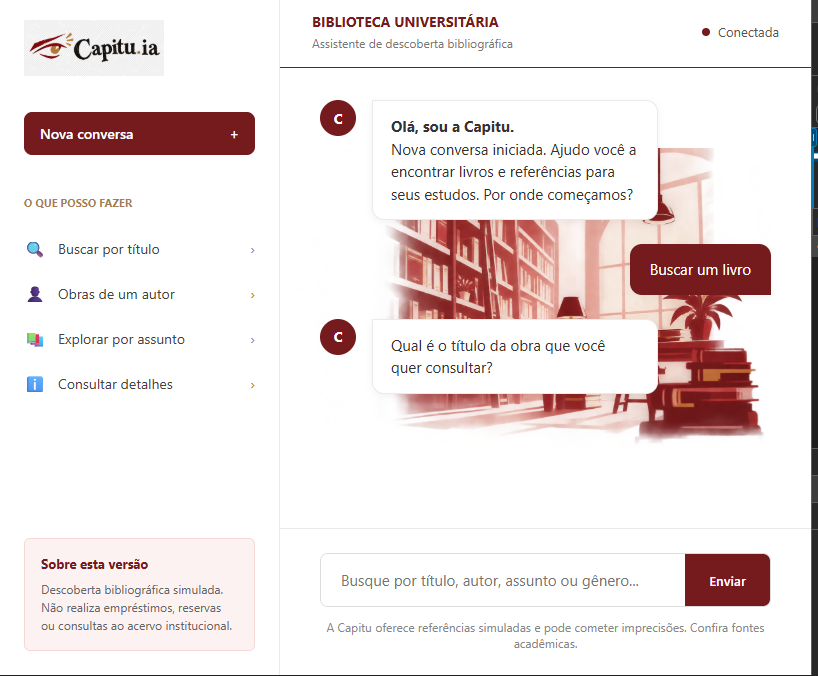

## UI-11 — Seleção pendente e troca de demanda

**Pré-condição:** conversa nova; busca que retorna múltiplos candidatos.

**Passos:**

1. Enviar “Procure Dom Casmurro” e registrar a ordem e os títulos dos candidatos.
2. Escolher “o segundo” e conferir a obra selecionada.
3. Perguntar “quem escreveu?” e conferir a correspondência com a seleção.
4. Repetir a busca em uma conversa nova e selecionar o segundo cartão por clique.
5. Perguntar “quem escreveu?” e conferir a correspondência.
6. Em uma nova conversa, enviar “Quero ler algo escrito por George Orwell” e, na mesma sessão, “Agora quero livros sobre astronomia”.
7. Conferir se a nova demanda substitui o contexto anterior.

**Esperado:** a lista preserva a ordem; a escolha por texto e por clique corresponde ao segundo candidato da sessão ativa. A pergunta de autoria refere-se à obra escolhida. A nova busca por astronomia não é tratada como continuação da busca anterior. O carregamento termina após cada resposta.

**Modo de execução e configuração:** execução ao vivo na Open Library, em sessões separadas.

**Resultado obtido:** “Procure Dom Casmurro” retornou 5 opções. Ao digitar “o segundo”, a aplicação exibiu corretamente a obra selecionada e, ao perguntar “quem escreveu?”, respondeu corretamente a autoria. Na repetição por clique, a lista foi exibida novamente; ao clicar no segundo cartão, a interface escreveu “o segundo” por extenso no chat, a seleção foi correta e a pergunta de autoria foi respondida corretamente. No cenário de troca de demanda, “Quero ler algo escrito por George Orwell” exibiu 5 opções de livros; na mesma sessão, a consulta sobre astronomia exibiu 5 opções relacionadas ao assunto, sem aproveitar o autor anterior. O carregamento terminou após cada resposta.

**Situação:** passou.

**Evidências:**

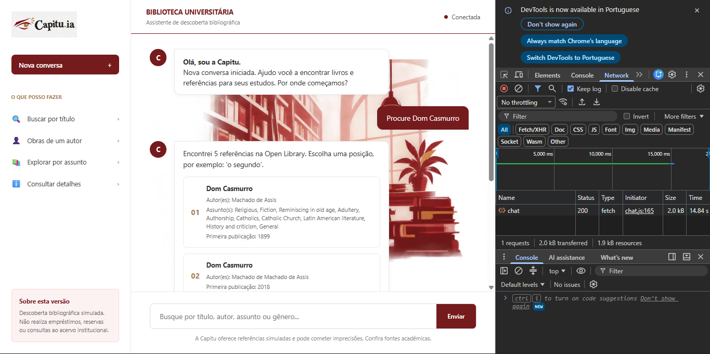

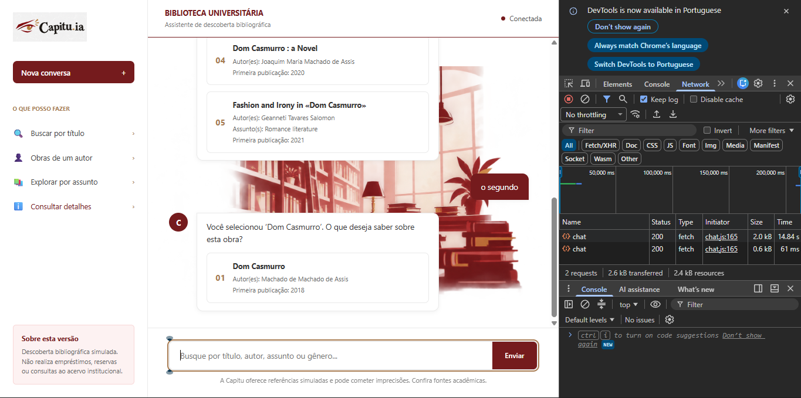

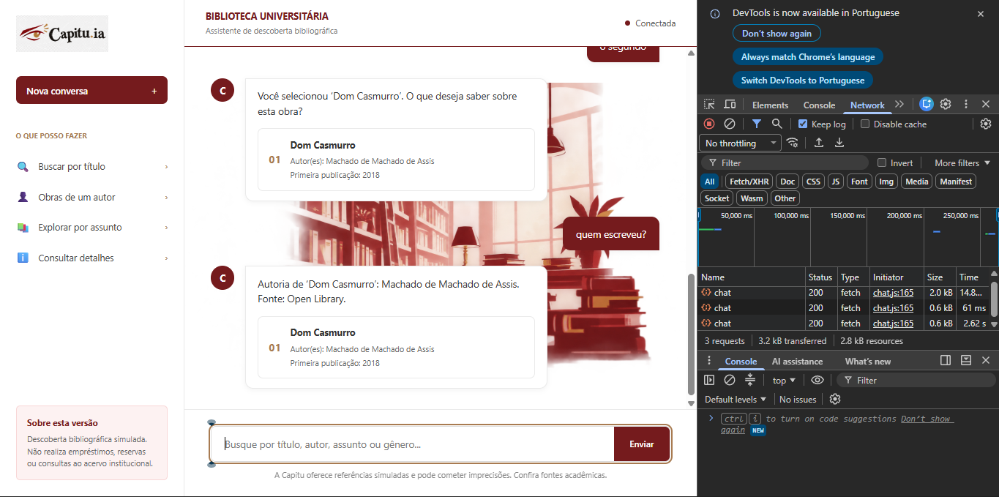

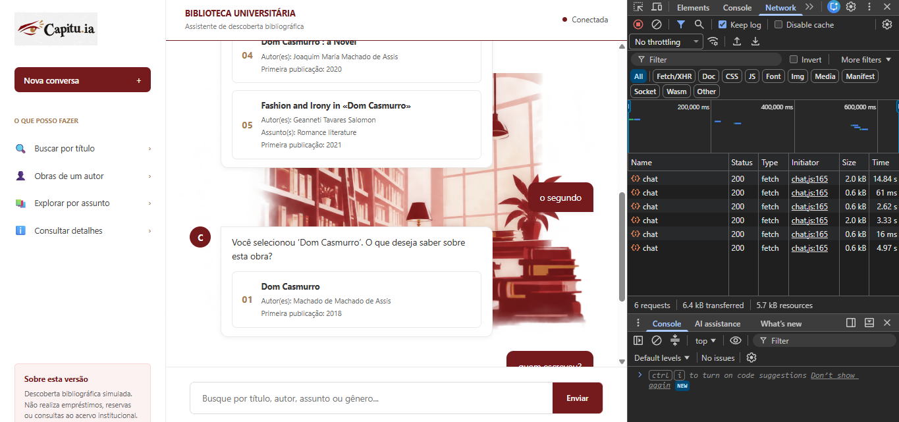

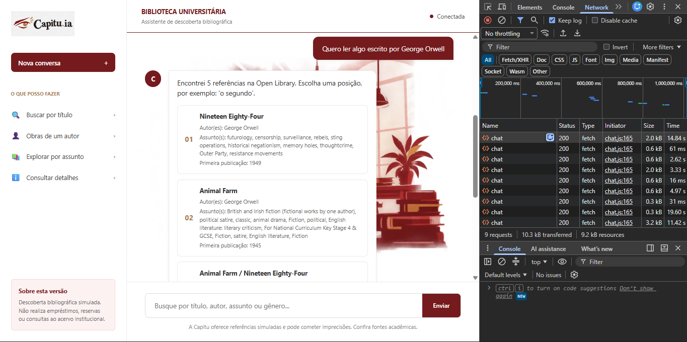

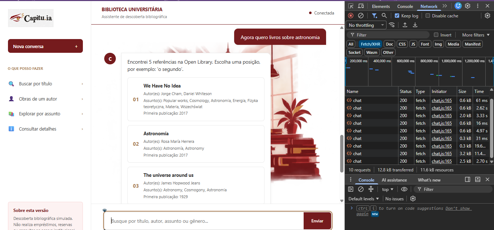

## UI-12 — Retorno vazio e fora do escopo

**Pré-condição:** conversa nova para cada variação.

**Passos:**

1. Enviar “Procure Zyx Livro 8472”.
2. Observar o texto, o estado e a ausência de cartões.
3. Iniciar nova conversa e enviar “Qual a previsão do tempo?”.
4. Comparar as duas respostas e verificar se é possível continuar.

**Esperado:** a busca vazia apresenta no_results e informa que não encontrou resultados na fonte, sem afirmar que o livro inexiste. A pergunta sobre previsão do tempo apresenta out_of_scope. As mensagens são distintas, sem cartões inventados, e o carregamento termina.

**Modo de execução e configuração:** execução ao vivo; a Open Library não retornou resultados para a busca (retorno vazio real, não simulado).

**Resultado obtido:** na variação de retorno vazio, a aplicação respondeu “Não encontrei referências na Open Library para essa busca. Isso não comprova que a obra não exista.”, sem cartões. Na variação fora do escopo, ao enviar “Qual a previsão do tempo?”, a aplicação informou que atende buscas e dados bibliográficos e que a solicitação está fora do escopo. A resposta HTTP 200 retornou state: out_of_scope, intent: null e results: []. Nenhum cartão foi exibido, o carregamento terminou e o campo foi liberado para digitação nas duas variações.

**Situação:** passou.

**Evidências:**

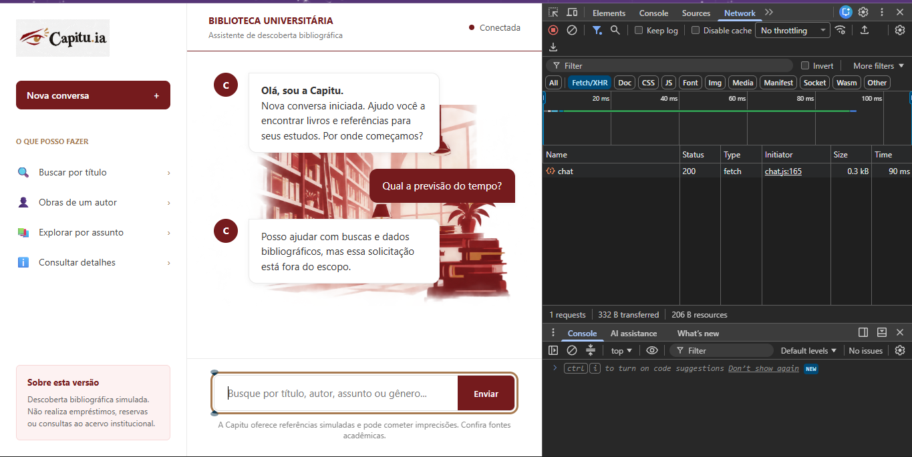

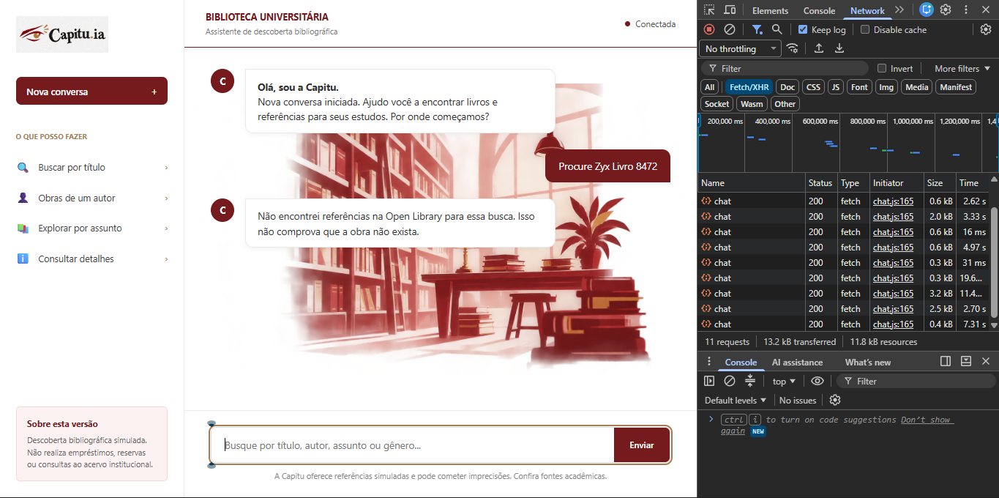

## UI-13 — Falha externa, HTTP 422 e falha de conexão

**Pré-condição:** mecanismos de teste definidos para cada falha. Falha da Open Library e falha de conexão com o CAPITU são registradas separadamente.

**Passos:**

1. Executar uma busca com falha da fonte externa simulada e registrar a resposta source_unavailable e a ausência de resultados.
2. Executar uma solicitação pela interface sob condição de HTTP 422 e observar a mensagem e a liberação dos controles.
3. Executar uma solicitação pela interface com falha de conexão (Offline) e observar a mensagem e a liberação dos controles.
4. Restaurar a condição normal e tentar novamente após cada falha.

**Esperado:** a falha externa é apresentada como indisponibilidade da fonte. HTTP 422 e falha de conexão recebem mensagens adequadas aos respectivos problemas. Em todas as variações, o carregamento termina, nenhum cartão é inventado e uma nova tentativa é possível após a recuperação.

**Mecanismos e configuração:**

- Falha externa: substituição de window.fetch no Console para alterar a resposta de /api/chat para state: source_unavailable, intent: null, results: [] e a mensagem de indisponibilidade. É uma simulação no navegador; valida a apresentação, não o backend.
- HTTP 422: substituição de window.fetch no Console para enviar o corpo “{}” a /api/chat, o que faz o servidor responder 422 de forma real.
- Falha de conexão: opção Offline da aba Network; conexão restaurada pela opção No throttling.
- Recuperação: recarregamento da página (F5) e novo envio.

**Resultado obtido:**

- Falha externa simulada (“Procure 1984”): a aplicação apresentou “A Open Library está indisponível no momento. Tente novamente mais tarde.”, sem cartões. O carregamento terminou. Após recarregar a página, a aplicação funcionou normalmente.
- HTTP 422: a interface apresentou “O servidor não aceitou esta solicitação. Revise a mensagem e tente novamente.”, com status “Servidor indisponível”. A aba Network registrou HTTP 422. O carregamento terminou e os controles foram liberados. Após recarregar a página e enviar “Busque um livro”, a aplicação respondeu normalmente, conforme a evidência de recuperação.
- Falha de conexão: com o navegador em Offline, o envio apresentou a mensagem “Não foi possível comunicar com o servidor. Tente novamente em instantes.” e o status “Servidor indisponível”, sem cartões. O carregamento terminou e permitiu nova interação. Após restaurar No throttling e reenviar “Busque um livro”, a aplicação solicitou o título da obra e apresentou o status “Conectada”.

**Situação:** passou nas três variações.

**Evidências:**

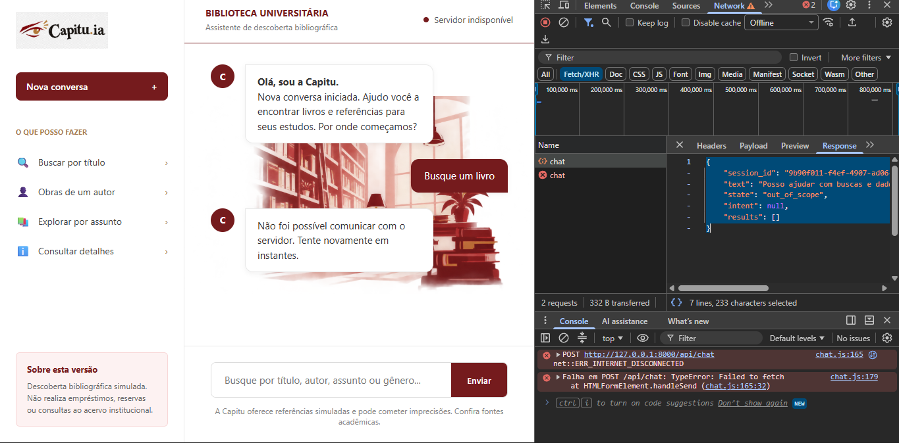

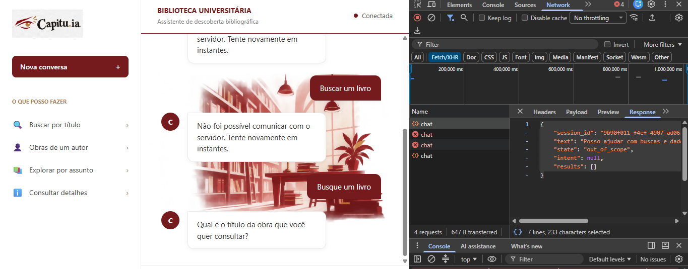

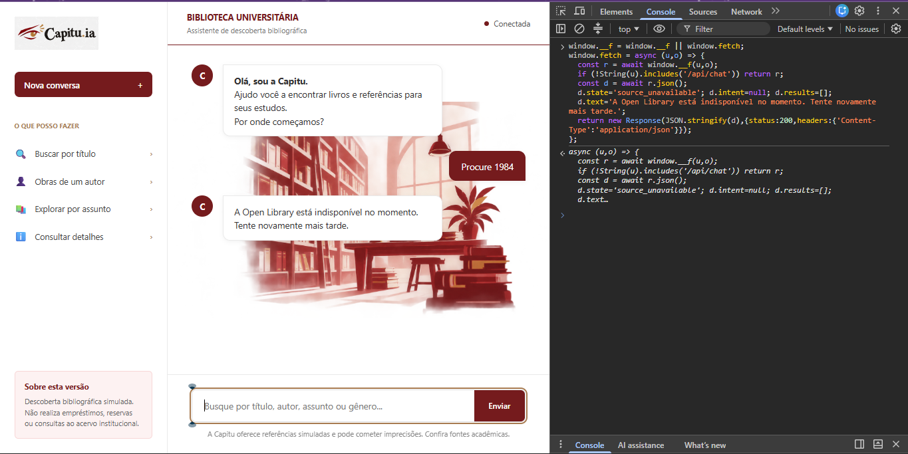

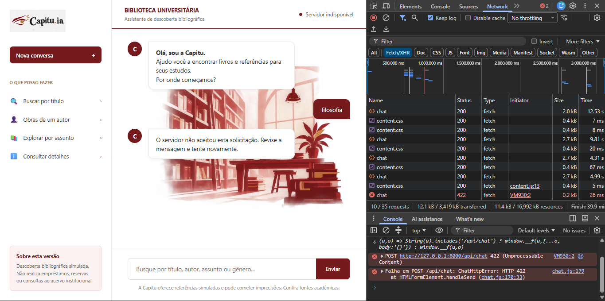

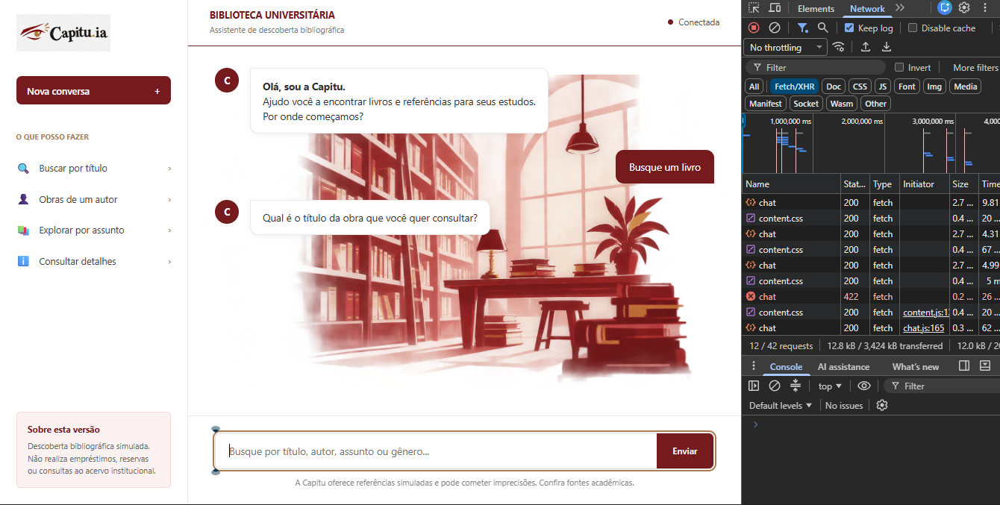

## UI-14 — Reenvio e término do carregamento

**Pré-condição:** conexão limitada para prolongar a resposta e condição de resposta que nunca chega para o teste de timeout.

**Passos:**

1. Selecionar o perfil 3G na aba Network e enviar uma mensagem.
2. Durante o carregamento, tentar reenviar por Enter e pelo botão de envio.
3. Conferir no Network a quantidade de requisições a /api/chat.
4. Aguardar a resposta e verificar a liberação dos controles; restaurar No throttling.
5. Simular uma resposta que nunca chega (substituição temporária de window.fetch no Console por uma promessa que nunca resolve), enviar uma mensagem e observar o carregamento por 12,63 segundos.

**Esperado:** tentativas durante o carregamento não geram envio ou mensagem duplicados. Após resposta, erro ou timeout, o carregamento termina e a interface permite nova interação.

**Resposta controlada, duração e limite de observação:** perfil 3G da aba Network para a lentidão (a opção Slow 3G não existe nesta versão do navegador); promessa pendente no Console para o timeout; observação por 12.63 s. Perfil restaurado para No throttling após a execução.

**Resultado obtido:**

- Sob 3G, a resposta demorou um pouco mais, mas foi concluída. Durante a exibição de “Consultando acervo...”, a interface bloqueou a digitação e o envio por Enter e pelo botão. Ao concluir, o carregamento terminou e os controles foram liberados. A aba Network registrou 1 requisição de chat.
- Timeout: com a resposta de /api/chat nunca chegando, o indicador “Consultando acervo...” permaneceu e os controles não foram liberados durante todo o tempo de observação. A interface só voltou ao normal após recarregar a página. O static/chat.js não define timeout para o fetch (verificado no código enviado). Registrado como defeito M05-D01.

**Situação:** reenvio e término do carregamento em resposta lenta: passou. Timeout: **falhou** (defeito M05-D01).

**Evidências:**

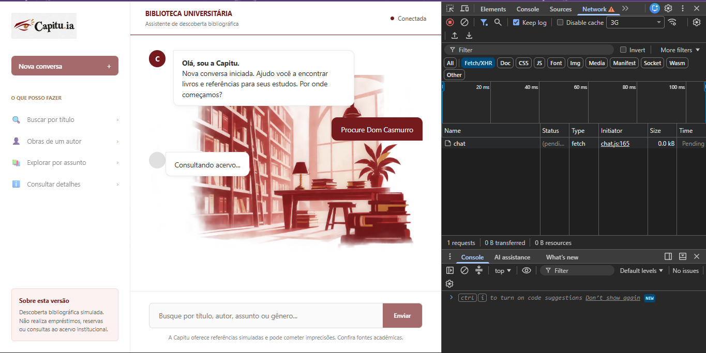

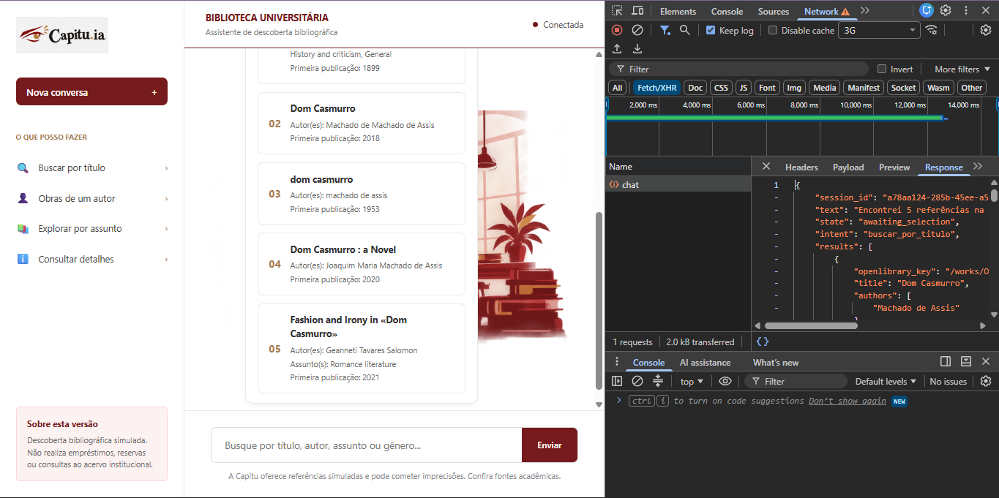

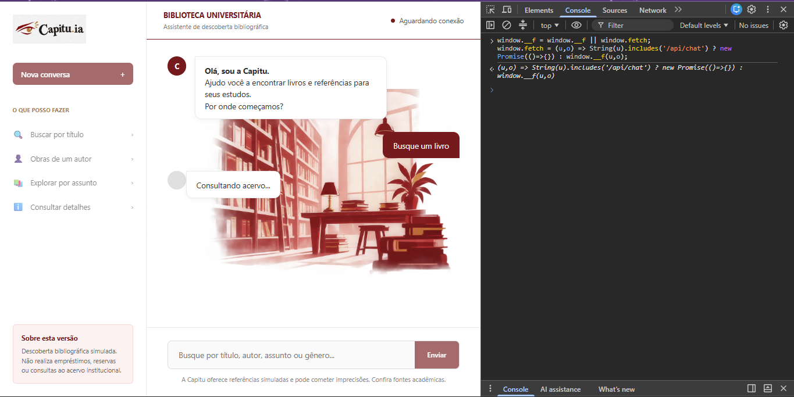

## Resumo dos casos

| Caso | Situação | Observação |
| --- | --- | --- |
| UI-09 Nova conversa | Passou | session_id nulo e UUID novo; contexto anterior não reaproveitado. |
| UI-10 Parâmetro ausente | Passou | Ausência de consulta ao catálogo evidenciada pelo T15 (G05) e pelo teste de integração. |
| UI-11 Seleção e troca de contexto | Passou | Seleção por texto e por clique; troca de Orwell para astronomia sem resíduo. |
| UI-12 Vazio e fora do escopo | Passou | no_results e out_of_scope com mensagens distintas. |
| UI-13 Falhas e recuperação | Passou | Falha externa simulada, HTTP 422 e Offline; recuperação confirmada. |
| UI-14 Reenvio e carregamento | Falhou (timeout) | Bloqueio de reenvio ok; defeito M05-D01. |

M05 cobre UI-09 a UI-14, conforme a issue; os modos ao vivo e simulados estão identificados. As buscas bibliográficas foram executadas ao vivo. As simulações no navegador verificam a apresentação e a recuperação da interface; os comportamentos internos do backend são referenciados na G05 e nos testes automatizados correspondentes.

## Registro de defeitos

### M05-D01 — Carregamento preso quando a resposta de /api/chat não chega (UI-14)

- Versão e ambiente: commit 2528cc20f812251f4ae762ece66bf02753de4ae4, branch test/m05-usabilidade-estados-erro-ui, http://127.0.0.1:8000/, navegador 157.0.8103.52, 17/11/2026.
- Configuração: substituição de window.fetch no Console para que /api/chat nunca responda.
- Pré-condição: aplicação aberta, conversa nova.
- Passos: 1) abrir o Console e executar o script que substitui window.fetch por uma promessa que nunca resolve para /api/chat; 2) enviar “Busque um livro”; 3) observar por 12,63 segundos.
- Resultado esperado: o carregamento termina com uma mensagem de erro ou timeout e os controles são liberados.
- Resultado obtido: “Consultando acervo...” permanece e os controles não são liberados até recarregar a página. O static/chat.js não define timeout para o fetch.
- Evidência: M05-screenshots/UI-14-03-timeout-carregando-preso.png.

## Observações (não são defeitos)

- UI-11: ao clicar em um cartão, a interface escreve “o segundo” por extenso no chat, ou seja, a seleção por clique usa o mesmo mecanismo da seleção por texto.
- Os dados exibidos vêm da Open Library ao vivo e podem variar entre execuções; os casos T03, T06, T09, T10, T12, T16 e T20 da G05 falharam no modo live e por isso não foram usados como entradas desta validação.